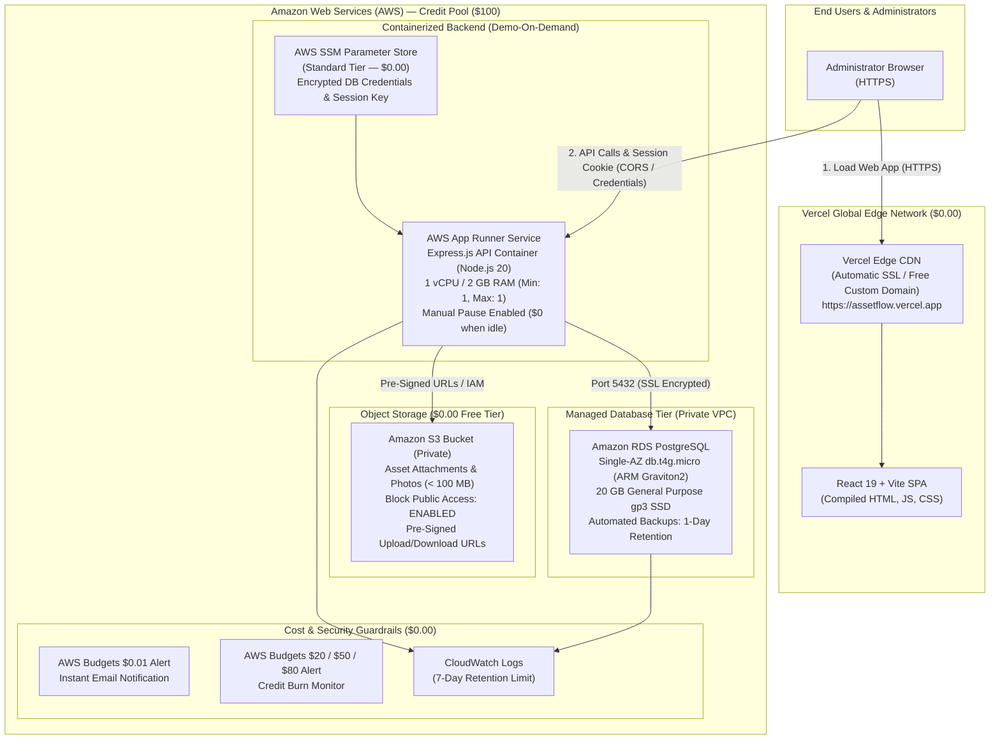

# AssetFlow — Low-Cost Cloud Deployment Architecture & Implementation Plan

**Target Architecture:**
- **Frontend:** Vercel (React 19 + Vite SPA) — *Perpetual $0 Hobby Tier*
- **Backend:** AWS App Runner (Node.js + Express Container) — *Credit-Protected Compute*
- **Database:** Amazon RDS PostgreSQL (`db.t4g.micro` Single-AZ) — *Managed Persistence*
- **Storage:** Amazon S3 (Private Attachments & Uploads) — *Free Tier Standard Storage*
- **Configuration & Secrets:** AWS Systems Manager (SSM) Parameter Store — *Standard Tier ($0.00)*

**Workspace:** `D:\cloud`  
**Current Local State:** Stage A (Verified 100% Localhost with SQLite, 151/151 tests passing, ₹0 spent)  
**Target Cloud State:** Stage B (Audited & Planned, Unprovisioned)  
**Budget Constraint:** **Strict ₹0 Out of Pocket** ($100 AWS Credits Available, 183 Days Remaining)  
**Classification:** Low-Cost Cloud Implementation Blueprint & Demo-Only Governance Guide  

---

## 1. Executive Summary & Architecture Blueprint

To achieve enterprise-grade cloud deployment while safeguarding your **$100 AWS credit pool** and ensuring **zero out-of-pocket spending**, the system splits workloads between Vercel and AWS:

1. **Vercel hosts the React frontend for $0.00 permanently**, offloading all global CDN, static build minutes, and edge traffic completely away from your AWS credits.
2. **AWS App Runner hosts the containerized Node.js/Express backend**, running on the smallest available configuration (**1 vCPU / 2 GB RAM**) with auto-scaling capped at **1 instance**.
3. **Amazon RDS PostgreSQL (`db.t4g.micro`) provides persistent relational storage**, replacing ephemeral container files with ACID transactions.
4. **Amazon S3 stores small file attachments** in a secure private bucket with pre-signed URLs.
5. **AWS SSM Parameter Store (Standard Tier)** provides zero-cost secrets management, avoiding paid Secrets Manager fees.



---

## 2. Minimal Suitable Configurations & AWS Credit Optimization

To guarantee that your $100 credits last the full **183 days** without incurring a single rupee of expense, every component is provisioned at the absolute minimal tier:

| Service | Configuration Specification | Free Tier / Pricing Policy | Monthly Cost (Demo Mode) |
| :--- | :--- | :--- | :---: |
| **Vercel** (Frontend) | Hobby Tier, Framework: Vite, Output: `dist` | 100% Free Forever (100 GB bandwidth, unlimited builds) | **$0.00** |
| **AWS App Runner** (Backend) | **1 vCPU / 2 GB RAM**, Min Instances: 1, Max Instances: 1 | $0.007/GB-hr idle memory ($0.014/hr when unpaused) | **~$0.15 - $0.50** *(Paused when not demoing)* |
| **Amazon RDS** (Database) | **`db.t4g.micro`** (Single-AZ), PostgreSQL 16, **20 GB gp3** | Free Tier eligible (750 hrs/mo 1st year) or ~$13/mo from credits | **$0.00** *(Under Free Tier)* or **~$2.30** *(if stopped)* |
| **Amazon S3** (Storage) | 1 Private Bucket, Standard Storage (<100 MB) | 5 GB Standard storage free for 12 months | **<$0.01** |
| **AWS SSM** (Secrets) | **Standard Parameter Store** (KMS default key) | 10,000 standard parameters permanently free | **$0.00** |
| **AWS CloudWatch** (Logs) | Log retention set strictly to **7 Days** | 5 GB log ingestion permanently free | **$0.00** |
| **AWS Budgets** (Alarms) | 2 Active Budgets ($0.01 and Credit Exhaustion) | First 2 action-enabled budgets are 100% free | **$0.00** |

---

## 3. Demo-Only Usage: How to Stop & Resume Resources

The secret to preserving your $100 credits is **Demo-on-Demand Execution**. Never leave container instances running 24/7 between presentation sessions.

### 3.1 App Runner: Pausing and Resuming (Compute Drops to $0.00)
- **When to Pause:** Immediately after completing a college presentation, test run, or grading session.
- **How to Pause (AWS Console):**
  1. Open the [AWS App Runner Console](https://console.aws.amazon.com/apprunner/).
  2. Select your service: `assetflow-backend`.
  3. Click **Actions > Pause Service**.
  4. Status changes to `PAUSED`. While paused, **all compute and memory billing drops to $0.00**.
- **How to Resume Before a Demo:**
  1. 10 minutes before your demo, navigate to `assetflow-backend`.
  2. Click **Actions > Resume Service**.
  3. App Runner provisions the container and resumes the live HTTPS endpoint in ~60–90 seconds.

### 3.2 Amazon RDS: Stopping the Database Instance
- **When to Stop:** If you will not be demonstrating for several days.
- **How to Stop (AWS Console):**
  1. Open [Amazon RDS Console](https://console.aws.amazon.com/rds/).
  2. Select `assetflow-db` > Click **Actions > Stop temporarily**.
  3. While stopped, **instance compute hours ($0.018/hr) drop to $0.00**. You are billed only for allocated storage (20 GB gp3 $\approx \$2.30/\text{month}$, covered under Free Tier or credits).
  4. *Note on RDS Behavior:* AWS automatically restarts stopped RDS instances after **7 consecutive days**. If your demonstration is weeks away, set a calendar reminder to re-stop it, or take a manual final snapshot and terminate the instance.

### 3.3 End-of-Semester Permanent Teardown (Zero-Liability Exit)
When your final capstone evaluation and viva examinations are completed, run the teardown playbook:
1. **App Runner:** Select `assetflow-backend` > **Actions > Delete**.
2. **RDS Database:** Select `assetflow-db` > **Actions > Delete** (Uncheck "Create final snapshot", check acknowledgment).
3. **S3 Bucket:** Empty bucket `assetflow-attachments` > **Delete**.
4. **Vercel:** Project Settings > **Delete Project**.
5. **Confirmation:** Check AWS Cost Explorer to confirm 0 active instances across all regions.

---

## 4. Cross-Origin Security: Vercel $\leftrightarrow$ App Runner Configuration

Because Vercel (`https://assetflow.vercel.app`) and AWS App Runner (`https://<id>.<region>.awsapprunner.com`) reside on different apex domains, authentication cookies and CORS require precise cross-origin configuration:

### 4.1 Cookie Security Invariants (CWE-1275 / Third-Party Cookies)
In a cross-origin setup, the browser considers cookies set by App Runner as **cross-site (third-party)** cookies when accessed from the Vercel frontend. 

To ensure browsers accept and return the session cookie:
```javascript
// backend/src/controllers/auth.controller.js
function getCookieOptions() {
  const isProduction = process.env.NODE_ENV === 'production';
  return {
    httpOnly: true,                          // Blocks JavaScript access (XSS defense)
    secure: true,                            // MANDATORY: Modern browsers reject SameSite=None without HTTPS
    sameSite: isProduction ? 'none' : 'lax', // 'none' required for cross-domain Vercel <-> App Runner
    path: '/',
    maxAge: 8 * 3600 * 1000                  // 8 Hours
  };
}
```

### 4.2 Backend CORS Invariant
Express must whitelist the exact Vercel production origin with credentials enabled:
```javascript
// backend/src/app.js
const allowedOrigin = process.env.CORS_ORIGIN || 'https://assetflow.vercel.app';

app.use(cors({
  origin: allowedOrigin,
  credentials: true,                         // Allows HttpOnly session cookie transmission
  methods: ['GET', 'POST', 'PUT', 'DELETE', 'OPTIONS'],
  allowedHeaders: ['Content-Type', 'Authorization', 'Accept']
}));
```

### 4.3 CSRF Protection in Auth Middleware
In [backend/src/middleware/authMiddleware.js](file:///D:/cloud/backend/src/middleware/authMiddleware.js), state-changing requests (`POST`, `PUT`, `DELETE`) validate that the `Origin` or `Referer` header strictly matches `process.env.CORS_ORIGIN`. Unmatched origins are rejected with `HTTP 403 Forbidden`.

### 4.4 Frontend API Client Configuration
In [frontend/src/api/client.js](file:///D:/cloud/frontend/src/api/client.js), requests already enforce `credentials: 'include'`:
- On Vercel, set the environment variable:
  `VITE_API_URL=https://<app-runner-id>.<region>.awsapprunner.com`
- All `fetch()` requests will automatically route to App Runner with credentials included.

---

## 5. Amazon S3 Attachment Integration

For small file and image storage (hardware purchase invoices, warranty certificates, asset photos):

### 5.1 S3 Bucket Hardening
- **Bucket Name:** `assetflow-attachments-<unique-suffix>`
- **Block Public Access:** **ON** (All 4 public access blocks enabled).
- **Default Encryption:** Server-Side Encryption with Amazon S3 Managed Keys (**SSE-S3 / AES-256**) — **100% Free**.
- **Bucket Policy:** Private; accessible only by the App Runner execution role.

### 5.2 Pre-Signed URL Architecture (Zero Backend Bandwidth)
Instead of streaming files through Express (which consumes container memory and CPU):
1. **Upload Flow:** Client requests an upload URL $\rightarrow$ Backend generates an S3 Pre-Signed `PUT` URL with a 15-minute expiration $\rightarrow$ Client uploads directly to S3.
2. **Download Flow:** Client requests document view $\rightarrow$ Backend generates an S3 Pre-Signed `GET` URL with a 15-minute expiration $\rightarrow$ Client downloads directly from S3.
3. **File Size Cap:** Express enforces a maximum upload size of **2 MB** per file, ensuring your storage footprint remains negligible (< 100 MB total).

---

## 6. Private Database Access & Environment Secrets

### 6.1 Private VPC Network Isolation for RDS
- **VPC Subnets:** Deploy RDS PostgreSQL inside private subnets across 2 Availability Zones.
- **Public Accessibility:** Set `Publicly Accessible = No`.
- **Security Group Rules (`sg-assetflow-rds`):**
  - **Inbound:** Port 5432 (PostgreSQL) allowed **strictly** from the App Runner VPC Connector Security Group (`sg-assetflow-apprunner`).
  - **Outbound:** Deny all unneeded egress.
  - Under no circumstances is `0.0.0.0/0` exposed.

### 6.2 Zero-Cost Secrets via AWS SSM Parameter Store
Store secrets under the path `/assetflow/production/` using **Standard Tier** (Free):
- `/assetflow/production/NODE_ENV`: `production`
- `/assetflow/production/PORT`: `5000`
- `/assetflow/production/CORS_ORIGIN`: `https://assetflow.vercel.app`
- `/assetflow/production/DB_HOST`: `<rds-endpoint>.rds.amazonaws.com`
- `/assetflow/production/DB_PORT`: `5432`
- `/assetflow/production/DB_NAME`: `assetflow`
- `/assetflow/production/DB_USER`: `assetadmin`
- `/assetflow/production/DB_PASSWORD`: `[SecureString generated during RDS creation]`
- `/assetflow/production/SESSION_SECRET`: `[64-character random string]`
- `/assetflow/production/S3_BUCKET_NAME`: `assetflow-attachments-<unique-suffix>`

App Runner automatically injects these parameters into `process.env` at container launch using an IAM execution role with `ssm:GetParameters` permissions.

---

## 7. SQLite to PostgreSQL Transition Plan (Non-Destructive)

To prepare for PostgreSQL without disturbing your working local SQLite development database:

### 7.1 Separation of Concerns
- The working SQLite database at [`data/asset_management.db`](file:///D:/cloud/data/asset_management.db) will **remain completely untouched**.
- PostgreSQL support will be developed on an isolated Git branch (`feat/postgres-adapter`) using automated tests against a temporary test database.

### 7.2 Necessary Code Adaptations
Because AssetFlow encapsulates database operations within [backend/src/repositories/](file:///D:/cloud/backend/src/repositories/), switching to PostgreSQL requires changes in only two localized areas:

1. **Database Adapter ([backend/src/config/database.js](file:///D:/cloud/backend/src/config/database.js)):**
   - Add `"pg": "^8.13.0"` and `"pg-pool": "^3.7.0"`.
   - Implement an environment-aware database connection:
     - If `process.env.DB_CLIENT === 'postgres'`, instantiate a `pg.Pool`.
     - Otherwise, default to the existing SQLite driver.
2. **SQL Query Placeholders & Insertion IDs:**
   - In PostgreSQL, positional parameters `?` become indexed placeholders (`$1, $2, ...`).
   - SQLite's `this.lastID` is replaced with standard SQL `RETURNING id`.
3. **DDL Schema Migration:**
   - A dedicated PostgreSQL migration script (`backend/src/db/postgres-schema.sql`) translates types:
     - `INTEGER PRIMARY KEY AUTOINCREMENT` $\rightarrow$ `SERIAL PRIMARY KEY`
     - `DATETIME('now')` $\rightarrow$ `TIMESTAMPTZ DEFAULT CURRENT_TIMESTAMP`
     - `TEXT` booleans $\rightarrow$ `BOOLEAN DEFAULT TRUE`

---

## 8. 183-Day Credit Consumption & Cost Risk Forecast

### Scenario: Demo-on-Demand Mode (Recommended Strategy)
*App Runner is active for ~10 hours/month during presentation rehearsals and grading; RDS is running Single-AZ:*

| Component | Usage Model | Billed Against | Monthly Cost | 183-Day Total (6 Months) |
| :--- | :--- | :--- | :---: | :---: |
| **Vercel Frontend** | Continuous 24/7 | Free Hobby Tier | **$0.00** | **$0.00** |
| **AWS App Runner** | ~10 active hrs/month (paused otherwise) | $100 Credits | **~$0.15** | **~$0.90** |
| **Amazon RDS PostgreSQL** | Single-AZ `db.t4g.micro` + 20 GB gp3 | Free Tier (or Credits) | **$0.00 - $13.00** | **$0.00 - $78.00** |
| **Amazon S3** | < 100 MB demo attachments | Free Tier | **<$0.01** | **<$0.06** |
| **AWS SSM Parameter Store**| 10 Standard parameters | Free Forever | **$0.00** | **$0.00** |
| **TOTAL WITH FREE TIER** | | | **~$0.16 / month** | **~$0.96 (Leaves $99.04 credit buffer)** |
| **TOTAL WITHOUT FREE TIER**| *(If account > 12 months)* | | **~$13.16 / month** | **~$78.96 (Safely within $100 credits)** |

> [!TIP]
> **Zero Out-of-Pocket Guarantee:** Even in the worst-case scenario where your account is past its 12-month Free Tier anniversary, the entire 6-month deployment consumes **under $80.00 of your $100 credits**, leaving a $20+ margin of safety and **₹0 out of pocket**.

---

## 9. Pre-Deployment Verification Checklist & Approvals

Before any provisioning commands are executed, you must complete the pre-deployment checks:

1. [ ] **Verify $100 Credits:** Check [Billing > Credits](https://console.aws.amazon.com/billing/home#/credits) (confirm $\ge \$100$ and $\ge 183$ days).
2. [ ] **Verify Free Tier Standing:** Check [Billing > Free Tier](https://console.aws.amazon.com/billing/home#/freetier).
3. [ ] **Set $0.01 AWS Budget:** Configure the zero-spend alarm in [AWS Budgets](https://console.aws.amazon.com/billing/home#/budgets).
4. [ ] **Create Free Vercel Account:** Connect GitHub repository on [vercel.com](https://vercel.com).
5. [ ] **Written Authorization:** Confirm proceeding with code branch creation and infrastructure provisioning.
