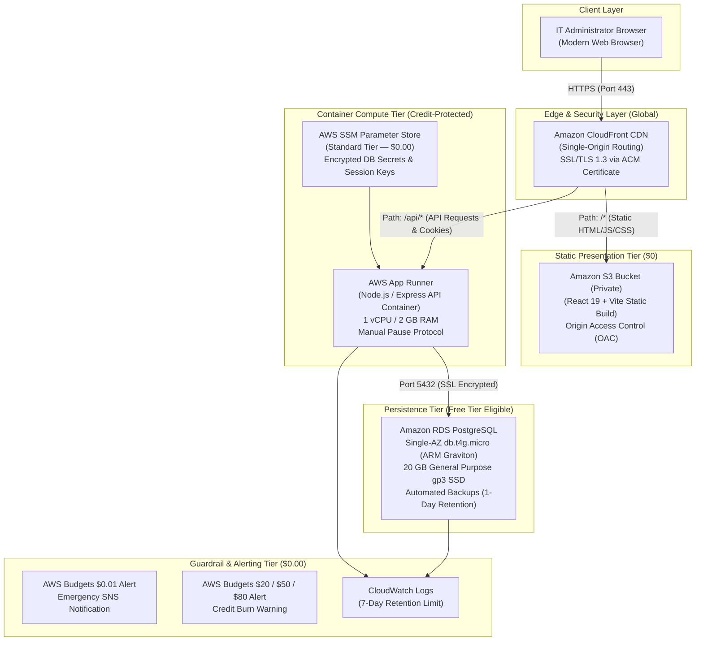

# AssetFlow — AWS Cloud Deployment Architecture & Implementation Plan

**Project:** AssetFlow — IT Asset & Software License Management System  
**Workspace:** `D:\cloud`  
**Current Operating State:** Stage A — Localhost Development (100% Verified, ₹0 Spent)  
**Target Operating State:** Stage B — AWS Cloud Deployment (Audited & Planned, Unprovisioned)  
**Budget Constraint:** **Strict ₹0 Out of Pocket** ($100 AWS Credits Available, 183 Days Remaining)  
**Document Classification:** Architecture Assessment, Security Blueprint, and Deployment Roadmap (Audit & Plan Only)

---

## 1. Executive Summary & Cloud Readiness Audit

A comprehensive inspection of the existing AssetFlow codebase ([README.md](file:///D:/cloud/README.md), [backend/src/](file:///D:/cloud/backend/src/), [frontend/src/](file:///D:/cloud/frontend/src/), [backend/src/db/schema.sql](file:///D:/cloud/backend/src/db/schema.sql)) confirms the following technical baseline:

| Dimension | Current Local Status | Cloud Deployment Readiness | Gap / Work Required for Cloud |
| :--- | :--- | :--- | :--- |
| **Test Suite** | 151 / 151 tests passed (110 backend, 41 frontend) | **Ready** | Automated tests validate core business invariants. |
| **Frontend Build** | Vite production bundle builds cleanly (328 kB JS) | **Ready** | Static assets in `frontend/dist/` ready for S3/Amplify upload. |
| **Authentication** | HttpOnly cookies, session table, bcryptjs | **Conditionally Ready** | Requires `secure: true` and single-origin or CORS/SameSite tuning. |
| **Application Layer** | Express REST API with input validation & rate limiting | **Ready** | Stateless controllers, easily containerizable for App Runner / ECS. |
| **Database Layer** | SQLite 3 embedded file (`data/asset_management.db`) | **NOT READY FOR CLOUD** | SQLite cannot run on stateless multi-instance cloud containers. |
| **Secrets & Config** | Local `.env` file | **Partially Ready** | Must migrate from `.env` to AWS Systems Manager (SSM) Parameter Store. |
| **Cost Safeguards** | ₹0.00 spent locally | **Pending Configuration** | AWS Budgets ($0.01 threshold) must be active before provisioning. |

---

## 2. Comparative AWS Options Matrix

### 2.1 Frontend Hosting Comparison

| Feature / Metric | Option A: AWS Amplify Hosting | Option B: Amazon S3 + CloudFront CDN (Recommended) |
| :--- | :--- | :--- |
| **Architecture** | Managed Git CI/CD service building React on push | Pre-built static bundle in private S3 bucket distributed via CloudFront edge locations |
| **Free Tier Allowance** | 1,000 build mins/month, 5 GB storage, 15 GB served/month (12-month limit) | CloudFront: **1 TB transfer out permanently free**; S3: 5 GB storage (12 months) |
| **Domain & SSL** | Free `*.amplifyapp.com` subdomain with automated SSL | Free `*.cloudfront.net` domain with free ACM SSL certificate |
| **Cookie / CORS Integration** | Separate domain from API $\rightarrow$ requires `SameSite=None; Secure` (cross-site cookie caveats) | **Unified Origin:** CloudFront can route `/*` to S3 and `/api/*` to App Runner on the **exact same domain** |
| **Credit Consumption Risk** | Build minutes can exceed limits if multiple pushes occur; post-12-month pricing applies | Extremely low cost (~$0.10 - $0.50/month), highly predictable, minimal credit drain |
| **Recommendation** | Good for automated CI/CD if Git connected | **RECOMMENDED:** S3 + CloudFront provides true single-origin routing for cookies and $0 permanent CDN tier |

---

### 2.2 Backend Compute Comparison

| Feature / Metric | Option A: AWS App Runner (Recommended) | Option B: AWS ECS Fargate | Option C: AWS Lambda (Serverless) | Option D: Amazon EC2 (`t3.micro`) |
| :--- | :--- | :--- | :--- | :--- |
| **Compute Model** | Fully managed container service | Container orchestration in custom VPC | Event-driven serverless functions | Self-managed virtual machine |
| **Setup Complexity** | Very Low: Points directly to container image | Moderate: Requires VPC, Subnets, Task Defs, ALB | Moderate: Requires serverless adapter wrapper | High: Manual OS setup, PM2, Nginx, certbot |
| **Load Balancing & SSL** | Built-in free HTTPS endpoint | Requires Application Load Balancer (**$16–$22/month flat!**) | Built-in via API Gateway ($1/million calls) | Manual Nginx reverse proxy + Certbot |
| **Idle Cost Behavior** | $0.007/GB-hr provisioned memory (~$10/mo 24/7) unless paused | Tasks run continuously; ALB incurs flat monthly charges | **Scales to true zero ($0.00 when idle)** | Free Tier (750 hrs/mo 1st year); new IPv4 fee ($3.60/mo) |
| **Credit Impact** | Low to moderate: Absorbed by $100 credits if paused when idle | **HIGH:** ALB alone consumes $20+/mo; drains credits fast | Lowest: 1M requests/mo permanently free | Low, but IPv4 fee applies and manual maintenance required |
| **Recommendation** | **RECOMMENDED for Demo:** Simple, reliable, zero ALB cost; pause service between grading sessions | Avoid for capstone due to mandatory ALB cost trap | Excellent long-term alternative if adapting Express app | Viable only if experienced with Linux VM administration |

---

### 2.3 Database Persistence Comparison

| Feature / Metric | Option A: SQLite on Local Container | Option B: SQLite on AWS EFS (NFS) | Option C: Amazon RDS PostgreSQL (Recommended) | Option D: External Serverless Postgres (Neon / Supabase) |
| :--- | :--- | :--- | :--- | :--- |
| **Persistence** | **NONE:** Data destroyed on restart/redeploy | Persistent network filesystem | Persistent managed database volume (gp3 SSD) | Cloud persistent managed instance |
| **Multi-Instance Safety** | Split-brain corruption | Latency spikes & `SQLITE_BUSY` deadlocks | Fully ACID compliant, connection pooled | Fully ACID compliant, serverless scaling |
| **Free Tier Allowance** | $0 | 5 GB EFS free (12 months) | **750 hours/month Single-AZ `db.t4g.micro` + 20 GB SSD** | Permanent free tier (e.g. Neon 0.5 GB, 0 credit card) |
| **Migration Required** | None | None | SQL dialect adaptation (`pg` pool, `SERIAL`, `$1`) | SQL dialect adaptation (`pg` pool, `SERIAL`, `$1`) |
| **Credit Consumption** | $0 | $0.30/GB-month over 5 GB | 100% Free under 12-Month Free Tier; or ~$15/mo from credits | **$0.00 out of pocket, $0 credits consumed** |
| **Recommendation** | **FORBIDDEN IN CLOUD** | **NOT RECOMMENDED** (locking risks) | **RECOMMENDED FOR AWS:** Enterprise standard, covered by Free Tier / credits | **RECOMMENDED ZERO-RISK ALTERNATIVE:** 100% preserves AWS credits |

---

## 3. The SQLite Persistence Problem & PostgreSQL Transition Blueprint

### 3.1 Why SQLite Fails on Modern Cloud Containers

In local development, AssetFlow uses SQLite 3 ([backend/src/config/database.js](file:///D:/cloud/backend/src/config/database.js)), which writes to `data/asset_management.db`. While ideal for local execution, SQLite cannot be used in production cloud container environments:

```
[Incoming Admin Request]
          │
          ▼
┌────────────────────────────────────────────────────────┐
│ Cloud Container Orchestrator (AWS App Runner / ECS)     │
│                                                        │
│  ┌───────────────────────┐   ┌───────────────────────┐ │
│  │ Container Instance 1  │   │ Container Instance 2  │ │
│  │ [Ephemeral Disk]      │   │ [Ephemeral Disk]      │ │
│  │ asset_management.db   │   │ asset_management.db   │ │
│  └───────────────────────┘   └───────────────────────┘ │
└────────────────────────────────────────────────────────┘
          ▲                               ▲
          │                               │
[Writes Asset "AST-001" to DB 1]    [Reads DB 2: "AST-001" NOT FOUND!]
                   (SPLIT-BRAIN DESYNCHRONIZATION)
```

1. **Stateless Ephemerality:** Cloud containers have temporary local storage. When a container restarts, crashes, auto-scales down, or updates, the disk is wiped and rebuilt from the container image. All newly registered assets, employees, and licenses are lost.
2. **Multi-Instance Split-Brain:** When traffic causes horizontal scaling, each container instance maintains its own separate copy of SQLite. An administrator assigning a laptop on Instance 1 will not see the assignment reflected on Instance 2.
3. **NFS/EFS Locking Failures:** Mounting AWS EFS over network storage is explicitly discouraged by SQLite's maintainers. NFS client caching and file-locking latency cause `SQLITE_BUSY` transaction timeouts and catalog corruption under concurrent traffic.

### 3.2 Code Migration Blueprint: SQLite to PostgreSQL

Because AssetFlow isolates database operations in [backend/src/repositories/](file:///D:/cloud/backend/src/repositories/), switching to PostgreSQL requires modifying only the database adapter and query placeholders without rewriting business services or React components:

#### 1. Database Driver Swap:
- In `backend/package.json`: Add `"pg": "^8.13.0"` and `"pg-pool": "^3.7.0"`.
- Replace SQLite callback wrapper in [backend/src/config/database.js](file:///D:/cloud/backend/src/config/database.js) with a PostgreSQL connection pool:

```javascript
// Proposed backend/src/config/postgres.js
const { Pool } = require('pg');

const pool = new Pool({
  host: process.env.DB_HOST,
  port: parseInt(process.env.DB_PORT || '5432', 10),
  database: process.env.DB_NAME || 'assetflow',
  user: process.env.DB_USER,
  password: process.env.DB_PASSWORD,
  ssl: process.env.NODE_ENV === 'production' ? { rejectUnauthorized: false } : false,
  max: 10,
  idleTimeoutMillis: 30000,
  connectionTimeoutMillis: 5000,
});

module.exports = {
  query: (text, params) => pool.query(text, params),
  getClient: () => pool.connect(),
};
```

#### 2. SQL Dialect Conversions:
| SQLite Syntax (Current) | PostgreSQL Syntax (Target) | File Affected |
| :--- | :--- | :--- |
| `INTEGER PRIMARY KEY AUTOINCREMENT` | `SERIAL PRIMARY KEY` or `INT GENERATED ALWAYS AS IDENTITY` | [backend/src/db/schema.sql](file:///D:/cloud/backend/src/db/schema.sql) |
| `DATETIME('now')` / `TEXT` timestamps | `TIMESTAMPTZ DEFAULT CURRENT_TIMESTAMP` | [backend/src/db/schema.sql](file:///D:/cloud/backend/src/db/schema.sql) |
| Positional parameter `?` (`WHERE id = ?`) | Indexed parameter `$1` (`WHERE id = $1`) | All files in [backend/src/repositories/](file:///D:/cloud/backend/src/repositories/) |
| `this.lastID` (SQLite `run` callback) | `INSERT INTO ... RETURNING id;` | [backend/src/repositories/](file:///D:/cloud/backend/src/repositories/) |
| String concat `||` | String concat `||` (Compatible in both) | [backend/src/repositories/asset.repository.js](file:///D:/cloud/backend/src/repositories/asset.repository.js) |

---

## 4. Safest Recommended Architecture

To maintain strict compliance with the **₹0 out-of-pocket budget** and protect the $100 credit pool over the full 183-day timeline, the following architecture is recommended:



---

## 5. Security & Configuration Blueprint

### 5.1 Single-Origin Cookie & CORS Architecture (CWE-1275 / CSRF Defense)

A major pitfall in cloud deployments is hosting frontend on `https://d123.amplifyapp.com` and backend on `https://xyz.awsapprunner.com`. Browsers treat these as **cross-site origins**, requiring:
1. `SameSite=None; Secure` cookies, which modern browsers (Safari ITP, Chrome Privacy Sandbox) increasingly drop or block as third-party tracking cookies.
2. Complex CORS pre-flight `OPTIONS` requests on every API call.

#### The Single-Origin CloudFront Solution:
By placing Amazon CloudFront in front of both tiers:
- `https://assetflow.yourdomain.com/*` $\rightarrow$ Routes to S3 (Static React SPA).
- `https://assetflow.yourdomain.com/api/*` $\rightarrow$ Routes to App Runner (Express REST API).

**Security Advantages:**
- **First-Party Cookies:** Cookies are transmitted on the exact same domain origin.
- **Cookie Settings:** `httpOnly: true`, `secure: true`, `sameSite: 'lax'`, `path: '/'`.
- **Zero CORS Preflight:** Browser considers frontend and backend identical origins, eliminating preflight latency and CORS misconfiguration risks.
- **CSRF Defense:** [backend/src/middleware/authMiddleware.js](file:///D:/cloud/backend/src/middleware/authMiddleware.js) validates that state-changing requests originate from the expected domain.

### 5.2 Environment Secrets Management (AWS SSM Parameter Store)

> [!IMPORTANT]
> **Use AWS Systems Manager (SSM) Parameter Store (Standard Tier), NOT AWS Secrets Manager.**  
> AWS Secrets Manager costs **$0.40 per secret per month**. Storing 5 secrets costs $2.00/month continuously.  
> In contrast, **AWS SSM Parameter Store Standard Tier is 100% free ($0.00/month)**.

Parameters configured under `/assetflow/production/`:
- `/assetflow/production/NODE_ENV`: `production`
- `/assetflow/production/PORT`: `5000`
- `/assetflow/production/DB_HOST`: `assetflow-db.xyz.us-east-1.rds.amazonaws.com`
- `/assetflow/production/DB_PORT`: `5432`
- `/assetflow/production/DB_NAME`: `assetflow`
- `/assetflow/production/DB_USER`: `assetadmin`
- `/assetflow/production/DB_PASSWORD`: `[SecureString generated during RDS creation]`
- `/assetflow/production/SESSION_SECRET`: `[64-character random cryptographically secure string]`
- `/assetflow/production/CORS_ORIGIN`: `https://assetflow.yourdomain.com` (or CloudFront domain)

### 5.3 Database Access & VPC Network Isolation
- **Database Subnets:** Place RDS PostgreSQL inside a private database subnet group spanning 2 Availability Zones.
- **Public Accessibility:** Set `Publicly Accessible = No`.
- **Security Group Inbound Rule:**
  - **Type:** PostgreSQL (Port 5432)
  - **Source:** Restricted exclusively to the App Runner VPC Connector Security Group ID (`sg-apprunner-backend`).
  - **Never** allow `0.0.0.0/0` (anywhere).
- **SSL Invariant:** Enforce `sslmode=require` in database connection settings to encrypt all traffic in transit between App Runner and RDS.

### 5.4 IAM Least-Privilege Execution Role
Create an IAM Role `AssetFlowAppRunnerExecutionRole`:
- Trusted entity: `build.apprunner.amazonaws.com` and `tasks.apprunner.amazonaws.com`.
- Policies attached:
  - `AWSAppRunnerServicePolicyForECRAccess` (to pull container image).
  - Custom inline policy granting read-only access strictly to `/assetflow/production/*` parameters:

```json
{
  "Version": "2012-10-17",
  "Statement": [
    {
      "Effect": "Allow",
      "Action": [
        "ssm:GetParameters",
        "ssm:GetParameter",
        "ssm:GetParametersByPath"
      ],
      "Resource": "arn:aws:ssm:us-east-1:*:parameter/assetflow/production/*"
    }
  ]
}
```

---

## 6. Credit Consumption & 183-Day Horizon Projections

### Scenario A: Unattended Continuous 24/7 Hosting (HIGH RISK)
*If resources are left running continuously without pausing:*

| Service | Monthly Usage | Unit Rate | Monthly Bill | Credit Impact over 183 Days (6 Mo) |
| :--- | :--- | :--- | :--- | :--- |
| **AWS App Runner** | 720 hrs $\times$ 2 GB RAM | $0.007 / GB-hr | ~$10.08 / mo | ~$60.48 |
| **Amazon RDS PostgreSQL** | 720 hrs Single-AZ `db.t4g.micro` | Free Tier (or $0.018/hr) | $0.00 (Free Tier) or ~$13/mo | $0.00 (if Free Tier) or ~$78.00 |
| **Amazon S3 & CloudFront** | 5 GB storage + 10 GB transfer | Free Tier | ~$0.10 / mo | ~$0.60 |
| **CloudWatch Logs** | 1 GB logs | Free Tier | $0.00 | $0.00 |
| **SSM Parameter Store** | 8 Standard Parameters | Free Tier | $0.00 | $0.00 |
| **TOTAL (with Free Tier)** | | | **~$10.18 / month** | **~$61.08 (Leaves ~$38.92 buffer)** |
| **TOTAL (WITHOUT Free Tier)** | | | **~$23.18 / month** | **~$139.08 (EXCEEDS $100 CREDITS AT MO 4!)** |

> [!WARNING]
> If your AWS account is past its 12-month Free Tier anniversary, continuous 24/7 hosting will **exhaust your $100 credits in approximately 4.3 months**, causing your personal credit card to be charged for the remaining 50+ days!

### Scenario B: Demo-on-Demand (RECOMMENDED ZERO-RISK STRATEGY)
*App Runner is resumed only during active presentation, demonstration, and viva grading sessions:*

| Service | Monthly Usage | Cost Behavior | Monthly Bill | Credit Impact over 183 Days |
| :--- | :--- | :--- | :--- | :--- |
| **AWS App Runner** | ~20 active hours / month (paused rest of time) | Compute while active (~$1.50) | ~$1.50 / mo | ~$9.00 |
| **Amazon RDS PostgreSQL** | Single-AZ `db.t4g.micro` (running) | Free Tier (1st yr) or credit | $0.00 - $13.00 / mo | $0.00 - $78.00 |
| **Amazon S3 & CloudFront** | Static bundle hosted | Under permanent free tiers | ~$0.10 / mo | ~$0.60 |
| **TOTAL** | | | **~$1.60 - $14.60 / mo** | **$10.00 - $87.60 (Safely within $100)** |

---

## 7. Step-by-Step Implementation Roadmap (Approval Gates)

Any future deployment to AWS must proceed strictly through these sequential phases, each requiring written user authorization:

```
[Phase 1: Pre-requisites & Account Hardening]
  │ (Check credits, set $0.01 Budget Alarm, enable MFA)
  ▼
[Phase 2: PostgreSQL Compatibility Layer]
  │ (Create git branch 'feat/postgres-adapter', test with pg-pool)
  ▼
[Phase 3: Database & Secrets Provisioning]
  │ (Provision RDS db.t4g.micro, populate SSM parameters)
  ▼
[Phase 4: Container Build & App Runner Service]
  │ (Build Docker image, push to private ECR, start App Runner)
  ▼
[Phase 5: Frontend Build & CloudFront Distribution]
  │ (Build Vite dist, upload to S3, configure CloudFront single-origin)
  ▼
[Phase 6: Live Smoke Verification & Immediate Pause]
  │ (Verify login, CRUD, export, then PAUSE App Runner to save credits)
```

---

## 8. Exact Next Steps Requiring User Written Approval

Before a single command is run or resource created, the following actions must be reviewed and approved:

1. **Complete Phase 0 Console Verification:**
   - Execute all checks in [docs/AWS_ZERO_COST_CHECKLIST.md](file:///D:/cloud/docs/AWS_ZERO_COST_CHECKLIST.md).
   - Confirm active $100 credits and account 12-month Free Tier standing.
   - Confirm the **$0.01 AWS Budget** is active with your verified email alert.
2. **Select Database Provider Strategy:**
   - *Option 1 (All-AWS):* Amazon RDS PostgreSQL (`db.t4g.micro` Single-AZ). Covered by Free Tier if account < 12 months, or drawn against $100 credits.
   - *Option 2 (Zero-Credit Drain Alternative):* Neon.tech Serverless PostgreSQL (permanent free tier, $0 credits consumed, zero credit card risk).
3. **Approve Code Adaptation Branch:**
   - Authorize creating a separate Git branch `feat/postgres-adapter` to add PostgreSQL query support while leaving the working SQLite `master` branch untouched.
4. **Authorize Deployment Execution:**
   - Provide explicit written confirmation: *"I have verified my AWS credits, created the $0.01 budget alert, and authorize Phase 1 implementation."*
