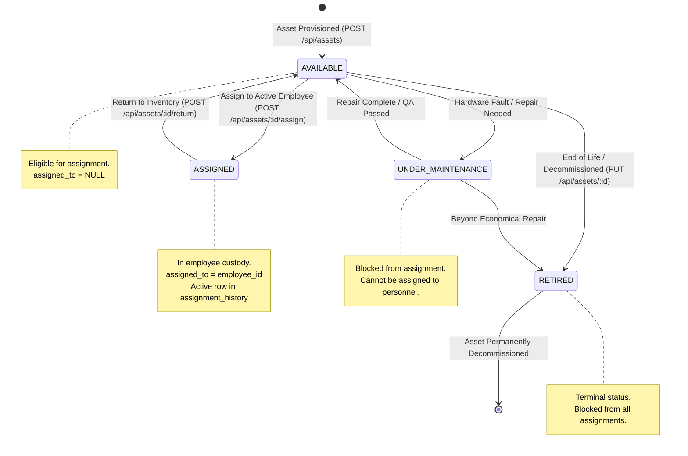
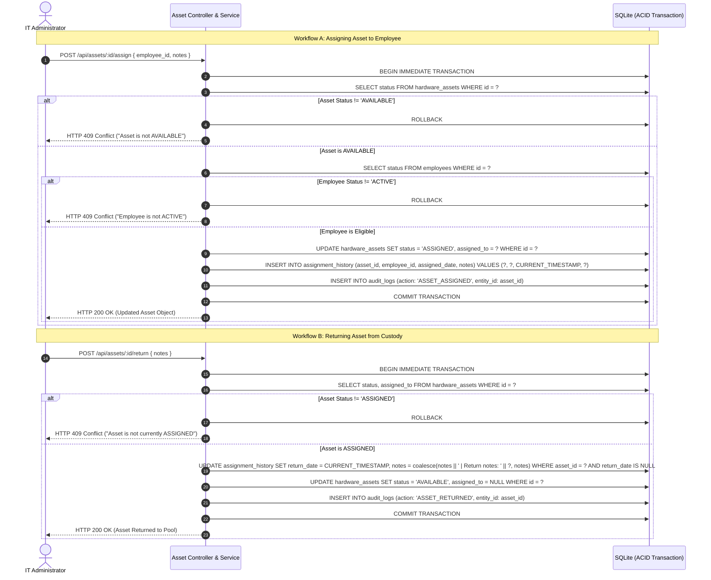

# Hardware Asset Lifecycle State Machine & Workflow

## Overview

Physical IT assets (laptops, servers, networking devices, monitors) transition through an audited, deterministic finite state machine. Transitions are atomic: assigning or returning an asset updates custody and writes a chronological audit trail in `assignment_history` within an ACID database transaction.

## Mermaid State Machine Diagram

## Mermaid Assignment & Return Transaction Sequence

## Data Integrity Guarantees

1. **Custody Preservation:** Assets can never be deleted if an assignment record exists in `assignment_history` (HTTP 409 Conflict).
2. **Atomic Transition:** The update to `hardware_assets` and the insertion/closure of `assignment_history` occur within the same SQLite transaction. If either fails, all writes roll back.
3. **No Phantom Assignments:** Terminated employees or employees on leave cannot be assigned hardware.
