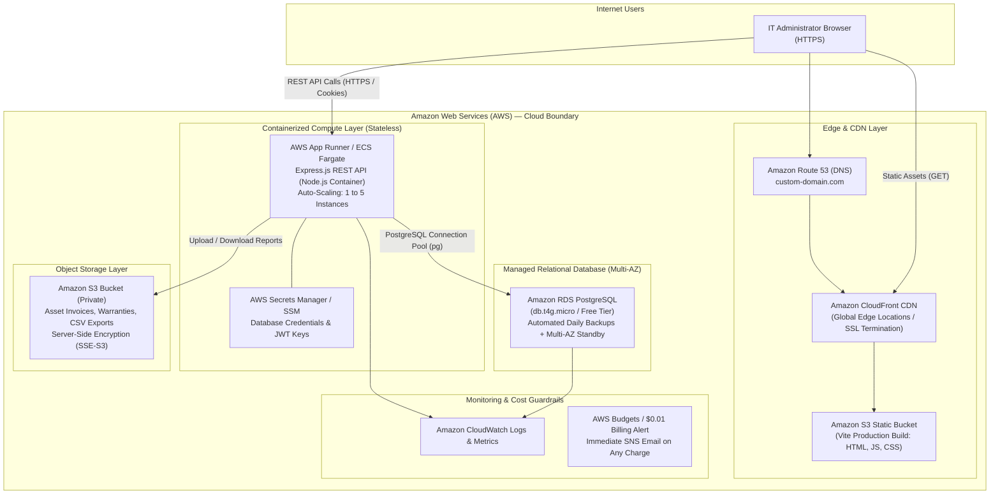

# Proposed Future AWS Cloud Architecture (Stage B — Not Implemented)

> [!IMPORTANT]
> **Status: PROPOSED ONLY — STRICTLY UNIMPLEMENTED.**  
> No AWS resources have been provisioned. Current operations remain 100% local at ₹0 cost. This document details the prospective transition to AWS cloud infrastructure if explicitly authorized in a future phase.

---

## Why Local SQLite Cannot Be Assumed Persistent in the Cloud

In modern cloud container platforms (AWS App Runner, AWS ECS Fargate, Kubernetes, Heroku, Google Cloud Run):
1. **Ephemeral Filesystems:** Container instances are stateless and ephemeral. When a container restarts, crashes, scales horizontally, or updates during deployment, all files written to local disk (including SQLite `.db` files) are erased immediately.
2. **Multi-Instance Concurrency:** When a cloud service scales to 2 or more container instances to handle traffic spikes, each instance would possess its own isolated SQLite file. Changes made by an administrator on Instance A would be completely invisible to Instance B, causing severe database corruption, conflicting asset assignments, and session invalidation loops.
3. **Network File Storage Limitations:** Mounting SQLite over network volumes (such as AWS EFS or NFS) is strongly discouraged by the SQLite documentation due to network latency, broken lock semantics, and file corruption risks under high concurrency.
4. **Conclusion:** Production cloud deployment requires a dedicated, persistent, managed relational database service (such as **Amazon RDS PostgreSQL**).

---

## Mermaid Proposed Cloud Architecture Diagram

## Migration Requirements: Stage A to Stage B

1. **Database Adapter Swap:** Replace `sqlite3` with `pg` (node-postgres) using PostgreSQL dialect scripts. The clean separation in AssetFlow's repository layer makes this transition modular.
2. **Containerization:** Create an optimized multi-stage `Dockerfile` (Alpine Node base, non-root user).
3. **Cookie Configuration:** Enforce `Secure: true` in production (`NODE_ENV=production`) ensuring cookies are transmitted exclusively over encrypted TLS (`https://`).
4. **Billing Safeguards:** Pre-configure AWS Billing Alarms set at $0.01 to catch accidental resource charges before deployment.
