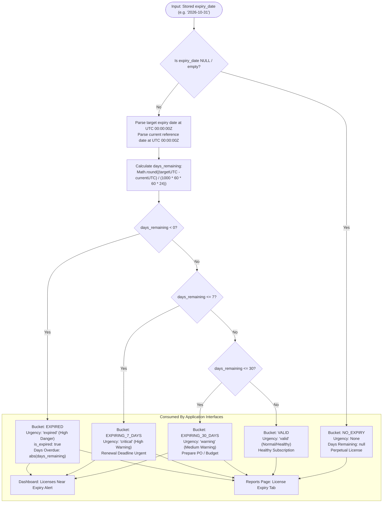

# License Expiry Classification Workflow

## Overview

AssetFlow implements an on-demand mathematical classification engine for software license subscriptions and hardware warranties. Unlike systems that rely on scheduled cron jobs (which can fail silently, drift, or lock databases), AssetFlow evaluates UTC date boundaries dynamically at query time directly against stored ISO date strings (`YYYY-MM-DD`).

## Mermaid Classification Decision Tree

## Boundary Invariants

| Category Bucket | Exact Mathematical Range | Visual Indicator | Urgency Level |
| :--- | :--- | :---: | :---: |
| **`EXPIRED`** | `days_remaining < 0` (strictly prior to today) | Red Badge | `expired` |
| **`EXPIRING_7_DAYS`** | `0 <= days_remaining <= 7` (next 7 calendar days) | Orange Badge | `critical` |
| **`EXPIRING_30_DAYS`** | `8 <= days_remaining <= 30` (days 8 through 30) | Amber Badge | `warning` |
| **`VALID`** | `days_remaining > 30` (greater than 30 days) | Green Badge | `valid` |
| **`NO_EXPIRY`** | `expiry_date IS NULL` | Slate/Blue Badge | `none` |

### Key Architectural Benefit

Because calculations use normalized UTC day-start timestamps (`00:00:00Z`), there is zero discrepancy caused by daylight saving time shifts, browser local timezones, or leap years.
