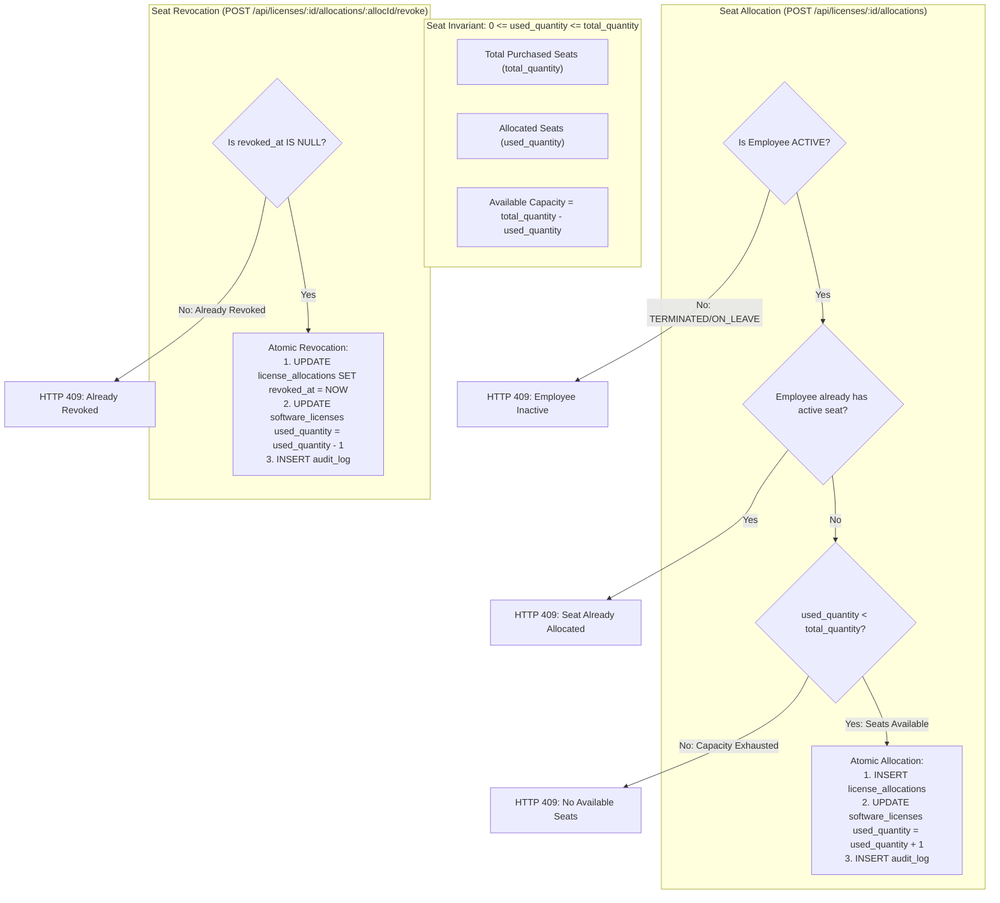
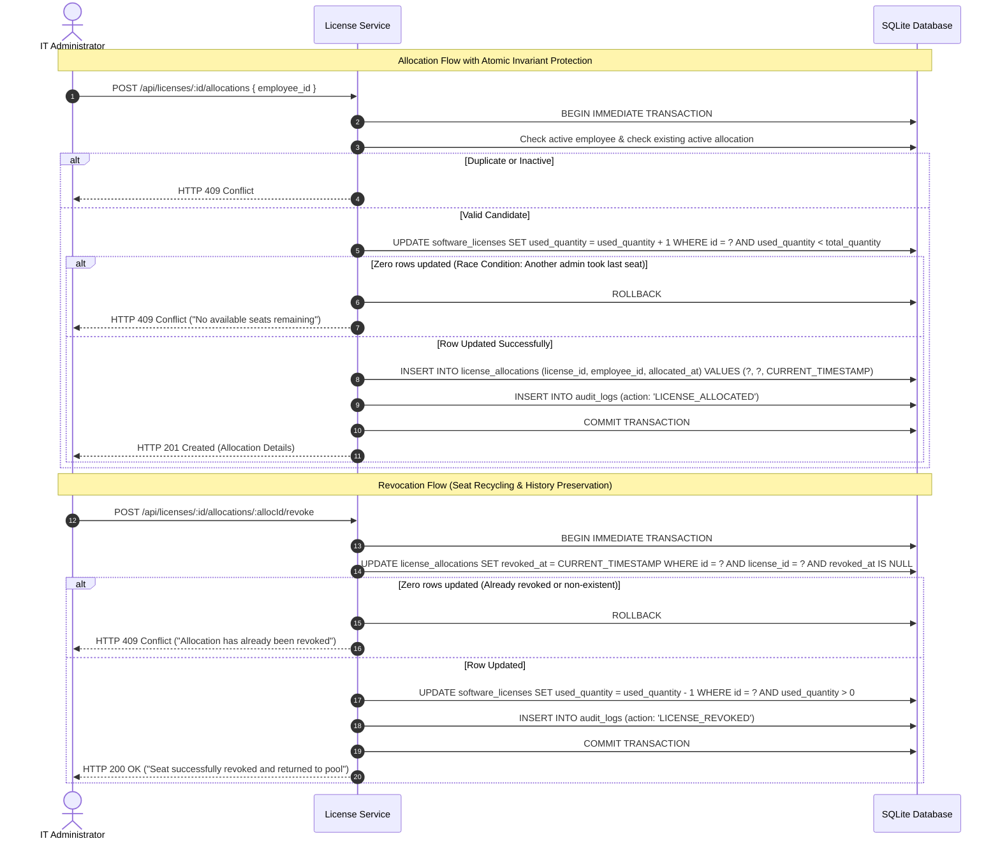

# Software License Allocation & Revocation Workflow

## Overview

Software license seat management requires strict concurrency controls to prevent license over-allocation (e.g. allocating 11 seats of a 10-seat license) and audit trails for compliance audits (BSA / vendor reviews). AssetFlow guarantees seat capacity invariants through conditional atomic SQL updates and non-destructive revocation timestamps.

## Mermaid License Invariant State Flow

## Mermaid Concurrency & Atomic Revocation Sequence

## Compliance Guarantees

1. **Non-Destructive Revocation:** When an employee leaves a department, their allocation record is not deleted; its `revoked_at` timestamp is recorded. This preserves complete historical evidence for vendor compliance audits.
2. **Safe Deletion Prevention:** Licenses with historical or active allocations cannot be deleted from the database (`HTTP 409 Conflict`). Administrators must mark them `CANCELLED` instead.
