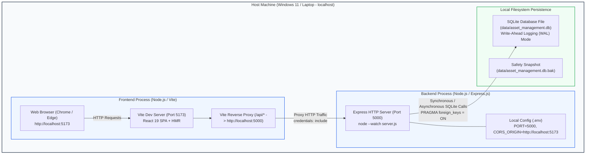

# Current Local Deployment Architecture — AssetFlow

## Overview

In Stage A (Local Development), AssetFlow runs entirely on the developer's laptop under Windows at strict ₹0 cost. No external cloud infrastructure, paid subscriptions, or container registries are required.

## Mermaid Local Deployment Topology

## Local Architecture Characteristics

| Attribute | Local Implementation | Rationale |
| :--- | :--- | :--- |
| **Hosting Model** | Local processes managed by npm scripts | ₹0 cloud spending, zero cloud credential risks |
| **Frontend Server** | Vite Dev Server on `http://localhost:5173` | Instant Hot Module Replacement (HMR) and automatic API proxying |
| **Backend Server** | Node.js + Express on `http://localhost:5000` | Native Node `--watch` reload on file edits |
| **Database** | Embedded SQLite 3 file in `data/asset_management.db` | Single file, zero-configuration, atomic ACID transactions, no background database server needed |
| **Session Storage** | Dedicated `sessions` table in SQLite file | Server-managed session lifecycle with automatic database-level TTL checks |
| **Security Envelope** | `CORS_ORIGIN=http://localhost:5173`, `SameSite=Lax`, `HttpOnly=true` | Strict browser isolation with credentials support |
