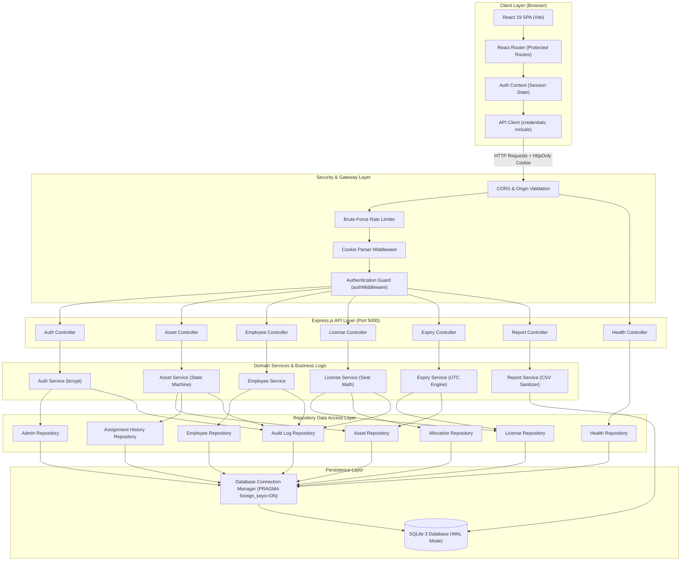

# System Architecture Diagram — AssetFlow

## Overview

AssetFlow implements a clean, decoupled layered enterprise architecture. The React 19 single-page application (SPA) communicates via HTTPS/HTTP REST endpoints with an Express.js backend. The backend enforces defense-in-depth security with cookie authentication, origin validation, route controllers, domain services, and an abstracted repository layer querying SQLite (local development) with ACID transactions.

## Mermaid Architecture Diagram

## Architectural Characteristics

1. **Separation of Concerns:** Business rules (such as seat capacity invariants or custody status transitions) reside exclusively in domain services, keeping controllers thin and repositories focused on parameterized queries.
2. **Cookie-Only Session Security:** Session tokens are stored in `HttpOnly`, `SameSite=Lax` cookies, preventing cross-site scripting (XSS) token exfiltration.
3. **Database Portability:** Repositories use standard ANSI SQL with parameter binding (`?`), enabling zero-rewrite migration to Amazon RDS PostgreSQL in Stage B.
